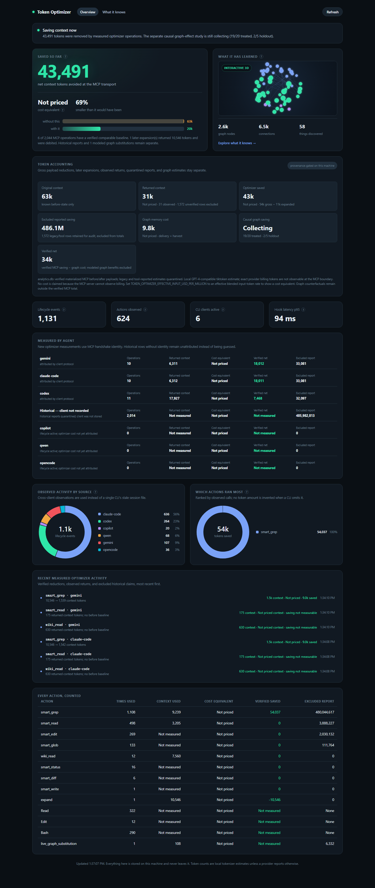
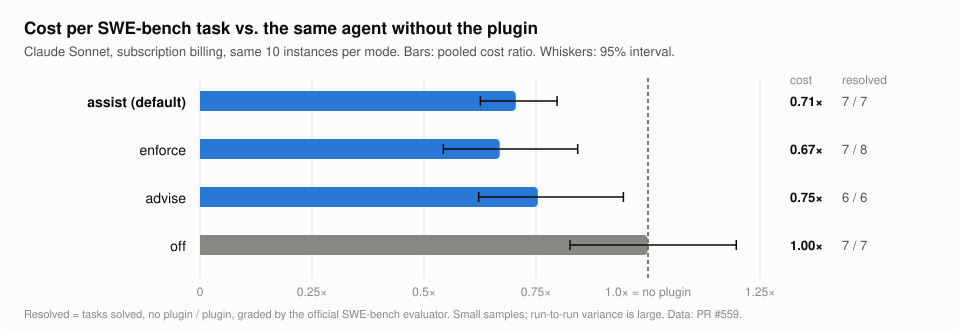
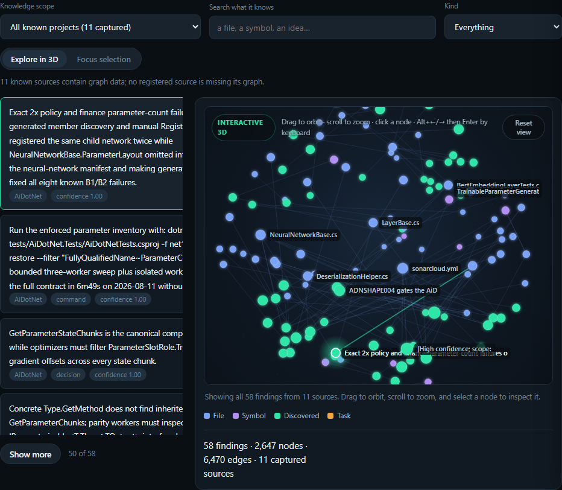

[](https://mcptoplist.com/server/io.github.ooples%2Ftoken-optimizer-mcp)

<p align="center">
  
</p>

<h1 align="center">Token Optimizer MCP</h1>

<p align="center">
  <strong>Cut what your AI coding agent costs without cutting what it gets done.</strong><br>
  Hooks, a proxy, and an MCP server for Claude Code, Codex, Copilot, Gemini and 12 more clients.
</p>

<p align="center">
  <a href="https://www.npmjs.com/package/@ooples/token-optimizer-mcp"></a>
  <a href="https://www.npmjs.com/package/@ooples/token-optimizer-mcp"></a>
  <a href="https://github.com/ooples/token-optimizer-mcp/actions/workflows/ci.yml"></a>
  <a href="./LICENSE"></a>
  <a href="https://nodejs.org/"></a>
</p>

<p align="center">
  <a href="#quick-start">Quick start</a> ·
  <a href="docs/HOW_IT_WORKS.md">How it works</a> ·
  <a href="docs/COMPARISON.md">Benchmarks</a> ·
  <a href="docs/INSTALLATION.md">All 16 clients</a> ·
  <a href="docs/REFERENCE.md">Reference</a> ·
  <a href="docs/CHANGELOG.md">Changelog</a>
</p>

On SWE-bench Verified, Claude Code with the plugin in its default mode solved the
same tasks as Claude Code without it, at **0.71× the cost** (7 of 7 resolved in
both arms; across nine runs, 84 tasks resolved without the plugin and 83 with
it). It gets there by stopping the waste agents make on their own: re-reading
files that have not changed, dumping whole files to see three lines, unbounded
searches, and re-deriving what an earlier session already worked out. Everything
runs locally. No account, no hosted service, and telemetry is off unless you
opt in twice.

<p align="center">
  
</p>
<p align="center"><em>The local dashboard: one ledger for every agent, every saving, and what the optimizer itself cost.</em></p>

## Quick start

**Claude Code.** Install the plugin rather than the bare MCP server: the plugin's
hooks do the saving, while the server alone only offers tools the model can ignore.

```text
/plugin marketplace add ooples/token-optimizer-mcp
/plugin install token-optimizer@token-optimizer
/reload-plugins
```

You need Node.js 22.14 or later on Claude Code's PATH, and Claude Code 2.1.139 or
later. Then check it works:

```bash
npx token-optimizer-doctor
```

The doctor feeds a synthetic payload to the real hook and confirms a large read is
handled. Every failure names its own fix.

**Codex, Copilot CLI, Gemini CLI, Cursor and the rest.** Every client runs the
same server, `npx -y @ooples/token-optimizer-mcp@latest`. Ready-made configuration
for each one is in [`src/integrations/`](./src/integrations), and
[docs/INSTALLATION.md](docs/INSTALLATION.md) walks through all sixteen.

<details>
<summary><strong>Requirements and what happens without them</strong></summary>

- **Node.js 22.14.0 or later**, for the hooks and the MCP server. `node` must be on
  the PATH of the client process. If you just installed Node.js or Git, start the
  client again from a new terminal so it picks up the new PATH.
- **Claude Code 2.1.139 or later.** The hooks use the exec form
  (`"command": "node", "args": [...]`). An older Claude Code ignores `args`, so the
  hooks silently do nothing; the doctor reports it.
- **If `node` cannot start**, the hooks let the tool call through
  (`"onFailure": "continue"`): you lose the savings, not the session. The MCP server
  shows as disconnected in `/mcp` until Node is reachable.

Full details: [docs/INSTALLATION.md](docs/INSTALLATION.md#requirements-and-data).

</details>

## Does it pay for itself?

<p align="center">
  
</p>

Each mode was run on the same 10 SWE-bench Verified instances, paired against a
control session with no plugin. Resolution is graded by the official evaluator.
`off` lands at 1.00×, which is what it should do: with the hooks and the proxy
off, the product costs nothing extra and saves nothing.

| Run (SWE-bench Verified, Claude Sonnet)   | Instances | Cost vs. control       | Resolved, control / plugin |
| ----------------------------------------- | --------: | ---------------------- | -------------------------: |
| Default mode (`assist`), first session    |        10 | **0.705×** [0.63–0.80] |                      7 / 7 |
| Learned cost control, after the hoist fix |        15 | **0.634×** [0.54–0.74] |             14 / 14 (of 15) |
| `off` (MCP server only)                   |        10 | 0.999× [0.83–1.20]     |                      7 / 7 |

The samples are small and run-to-run variance is large, so read these as
directions with intervals, not guarantees. The full method, every run including
the ones where it lost, and the per-instance data are in
[PR #559](https://github.com/ooples/token-optimizer-mcp/pull/559).

## How it compares

**Short answer: it saves more than every competitor we tested, in like-for-like
runs, except one small Claude Code task against Headroom, which is a tie.** The
fairness notes and every loss are below the table.

| Competitor                 | How it was tested                                                  | Them                         | Token Optimizer                 | Result                                 |
| -------------------------- | ------------------------------------------------------------------ | ---------------------------- | ------------------------------- | -------------------------------------- |
| **Headroom**               | Tokens removed on Headroom's own benchmark, 18 workloads           | 61.4%                        | 91.5%                           | ✅ **Win**                             |
| **Headroom**               | Installed proxy vs ours, 120 Codex task pairs                      | $30.43 est. cost, 120/120 passed | $22.26 est. cost, 119/120 passed | ✅ **26.9% cheaper**, 30.1% faster on average |
| **Headroom**               | Installed proxy vs ours, one small Claude Code task, 4/4 tests     | 48,626 tokens                | 49,053 tokens                   | ➖ **Tie** (0.9% more)                 |
| **tokenjuice**             | Product installed, same coding tasks for every arm                 | 13.6% cheaper                | **33.6% cheaper**               | ✅ **Win**                             |
| **Tokenade**               | Its rules text vs our rules text (its CLI needs an account)        | 22.9% cheaper                | **32.0% cheaper**               | ✅ **Win**                             |
| **claude-token-optimizer** | Product installed, its hooks fixed so they fire on Claude Code     | 2.7% cheaper, within noise   | **33.6% cheaper**               | ✅ **Win**                             |

How each row was kept fair, and what it does not show:

- **claude-token-optimizer as shipped does nothing on Claude Code 2.1.251.** Its
  hooks read a `CLAUDE_TOOL_NAME` variable that Claude Code does not set, so they
  exit before checking anything. Scoring that would not be a fair comparison, so the row
  uses their product with that one line changed to read the hook input Claude Code
  actually sends. We confirmed the patched hooks fired and blocked oversized reads.
  Its CLAUDE.md ships as an unfilled template, which understates it.
- **Tokenade's product needs an account,** so only its rules text could run. It is
  compared with our rules text alone, not our full product. If its hooks save
  more, this row understates it.
- **Headroom, first row:** the 91.5% is our proxy. Like Headroom, it moves some
  content out of the request for the agent to fetch back if needed. Our
  compressor alone removes fewer tokens than Headroom on 8 of the 18 workloads.
- **Headroom, 120 pairs:** we wrote the 12 task families, including ones built to
  make our proxy fail, and froze the plan before any run. Headroom's mode setting
  is not recorded in that study. Our proxy crashed once (unknown usage) where
  Headroom passed every task, and ours cost more on 30 of the 120 pairs. It is
  cheaper on average, not on every task. Costs are over the 119 pairs where both
  finished.
- **The tokenjuice, Tokenade and claude-token-optimizer rows are one campaign:**
  1,050 runs on 2026-09-03, Claude Code 2.1.251, cost per finished task against
  plain Claude Code. Any of these products may have changed since. The campaign
  had no bias-control task, so a task set that happens to favour us cannot be
  ruled out.

Beyond the table:

- ✅ **Subscription plans go further.** It detects a subscription and optimizes
  for finished work per unit of quota, not per dollar. It spends leftover 5-hour
  capacity only while your week is on pace. Limit monitors show your usage; this
  acts on it.
- ✅ **Tasks still get done.** The same SWE-bench tasks were resolved with and
  without it (7 of 7), at 0.71× the cost.

<!-- ALT-A-CORPUS:START -- every figure between this marker and the next
     CORPUS:END must appear in `totals` of
     `bench/compression/alt-a/results/head-to-head.json`. Guarded by
     `node bench/compression/readme-alt-a.check.mjs`; do not hand-edit. -->

**On Headroom's own benchmark**, its fixtures and its harness, the proxy removes
**91.5%** of the tokens. Their best setting removes 61.4%. The proxy costs less
on **18 of 18** workloads when nothing it moved out is read back, and on 17 of 18
when all of it is.

<!-- ALT-A-CORPUS:END -->

**Where it loses:**

- Without the proxy, the compressor removes fewer tokens than Headroom on 8
  of 18 workloads. On those, they move content out of the request rather than
  shrink it.
- Against Headroom, ours cost more on 30 of 120 task pairs and crashed once;
  on one small Claude Code task Headroom used 0.9% fewer tokens.
- On one 342 KB-file task in the 2026-09-03 campaign, our hooks took about 6
  minutes per run against 0.3 for plain Claude Code. It cost no more in tokens,
  but it was slower.
- In the four-product run, most of the saving came from its rules file. The hooks
  added no measurable cost saving on top.

Raw data: [competitor campaign](bench/ledger/RESULTS-COMPETITORS.md),
[Headroom 120-pair study](bench/live/evidence/joint-confirmation-2026-09-16/README.md), and the Headroom
benchmark tables in [the comparison](docs/COMPARISON.md).

## What it does

- **Stops the expensive call before it happens.** On clients with a
  pre-execution hook, an oversized `Read`, `Grep`, `cat` or `grep -r` is routed to
  a cached, bounded replacement, or refused outright in `enforce` mode. Re-reading a file you already read this
  session returns only the diff.
- **Remembers what your agent worked out.** A per-project knowledge graph collects
  findings, decisions and dead ends as a side effect of normal work, and feeds them
  back when the agent touches the relevant file. Carrying a finding costs about 150
  tokens; re-deriving it costs 5k–50k.
- **Compresses what it cannot avoid.** Tool output, logs, JSON and search results
  are compressed with the prompt cache in mind: providers bill a cached prefix at
  0.1× and a rewritten one at 1.25×, so it optimizes the bill, not the byte count.
- **Measures itself and says when it is losing.** Savings are recorded before and
  after, with later expansions debited from the same total, and attributed per
  client and per operation. Modeled savings are kept apart from measured ones.
- **Works across 16 clients.** Ten can have wasteful calls refused; six get
  always-on routing rules where the host has no veto API.

<details>
<summary><strong>How it works: the four mechanisms</strong></summary>

1. **Hooks** sit in front of the client's built-in tools. In `enforce` mode a large
   read is denied with a message naming the cheaper call; in the default `assist`
   mode the hooks route, retrieve and capture without refusing anything.
2. **The proxy** sits between the client and the provider, compressing request
   bodies and keeping the cached prefix stable so cache reads stay cheap.
3. **The MCP server** provides `smart_read`, `smart_grep`, `smart_edit`,
   `optimize_text`, `token_audit` and the rest: diff-on-reread, bounded search,
   and an out-of-context store.
4. **The knowledge graph** is written by the hooks as the agent works and read
   back at the moment it is relevant.

More: [docs/HOW_IT_WORKS.md](docs/HOW_IT_WORKS.md).

</details>

<details>
<summary><strong>The knowledge graph</strong></summary>

```
you touch  src/auth.ts
           │
           ├─ verify() compares exp against the LOCAL clock          (finding, 0.9)
           ├─ per-host retry budgets; global was rejected — deadlock (decision)
           ├─ ! the skew fix was reverted once already               (dead end)
           └─ [git] 47 changes in 90d, last three: "fix token expiry",
                    "revert skew fix", "fix token expiry again"
```

None of that is in your repository. It exists only because an agent once spent
tokens finding it out, and it is gone at the end of the session unless something
keeps it. No ingestion job, no embedding model, no rebuild step.

More: [docs/HOW_IT_WORKS.md](docs/HOW_IT_WORKS.md#the-knowledge-graph--the-part-nothing-else-has).

</details>

<details>
<summary><strong>Modes: assist, enforce, advise, off</strong></summary>

| Mode               | What the hooks do                                         |
| ------------------ | --------------------------------------------------------- |
| `assist` (default) | Route, retrieve, capture and compress; refuse nothing     |
| `enforce`          | Also refuse large built-in reads and unbounded searches   |
| `advise`           | Suggest the cheaper call without refusing                 |
| `off`              | Hooks and proxy off; the MCP server's tools still work    |

Set it with `TOKEN_OPTIMIZER_MODE`. The chart above shows what each mode cost on
SWE-bench.

</details>

<details>
<summary><strong>Supported clients</strong></summary>

**Enforcing tier**: the client has a pre-execution hook, so a wasteful call can be
refused.

| Client             | What installs                                                                                  |
| ------------------ | ---------------------------------------------------------------------------------------------- |
| Claude Code        | Native plugin (see [Quick start](#quick-start))                                                |
| Codex              | Native plugin in [`src/integrations/codex/plugin`](./src/integrations/codex/plugin), or standalone hooks |
| GitHub Copilot CLI | Project hooks in [`src/integrations/copilot`](./src/integrations/copilot)                              |
| Gemini CLI         | Gemini extension at the repository root                                                        |
| Qwen Code          | Extension bundle in [`src/integrations/qwen`](./src/integrations/qwen)                                 |
| Cursor             | Project hooks and rule in [`src/integrations/cursor`](./src/integrations/cursor)                       |
| Cline              | Project hooks and rule in [`src/integrations/cline`](./src/integrations/cline)                         |
| OpenCode           | In-process plugin and hooks in [`src/integrations/opencode`](./src/integrations/opencode)              |
| Kilo               | In-process plugin and hooks in [`src/integrations/kilo`](./src/integrations/kilo)                      |
| Windsurf           | Project hooks and rule in [`src/integrations/windsurf`](./src/integrations/windsurf)                   |

**Rules tier**: Roo Code, Zed, Amp, Continue, Crush and Droid have no veto API, so
they get always-on routing rules instead.

Every config path is checked against the client's published documentation; see
[docs/CLIENT_SUPPORT.md](docs/CLIENT_SUPPORT.md).

</details>

<details>
<summary><strong>The dashboard</strong></summary>

<p align="center">
  
</p>

The dashboard reads the local ledger: verified savings, excluded reports,
per-agent attribution, hook health and the knowledge graph. It prices usage with
the exact provider, model and rate tier it captured, and leaves an ambiguous model
**Not priced** rather than guessing. More: [docs/DASHBOARD.md](docs/DASHBOARD.md).

</details>

<details>
<summary><strong>Privacy and telemetry</strong></summary>

- Nothing is measured about you unless you ask. Anonymous usage data takes two
  separate opt-ins: `TOKEN_OPTIMIZER_TELEMETRY=1` counts into a file on your own
  disk, and `TOKEN_OPTIMIZER_BEACON=1` is what uploads it. `DO_NOT_TRACK=1`
  overrides both.
- An event can hold only numbers and flags. A string is dropped before it is
  written, so a path, prompt or error message cannot travel even by mistake. The
  machine identifier is a salted hash, never your hostname.
- The version check runs only when you ask the doctor for a diagnosis, never
  during a session. `TOKEN_OPTIMIZER_UPDATE_CHECK=0` turns it off.
- `npx token-optimizer-doctor` prints which of these is on and what has been
  recorded.

Full details: [docs/HOW_IT_WORKS.md](docs/HOW_IT_WORKS.md#the-30-second-version).

</details>

<details>
<summary><strong>Verify the release, or remove it</strong></summary>

Releases are published from CI with npm provenance, so
`npm audit signatures` ties the package to the workflow run and the commit without
trusting us. `CHECKSUMS.sha256` ships alongside for offline checking.

To remove it, uninstall the plugin (`/plugin uninstall token-optimizer@token-optimizer`).
For a hook install, `npx token-optimizer-uninstall` shows the plan and changes
nothing; add `--apply` to carry it out. It removes only files that still match
what it wrote, and names anything you have edited since. Step by step:
[docs/INSTALLATION.md](docs/INSTALLATION.md#verify-it-check-it-remove-it).

</details>

## Documentation

| Page                                           | What is in it                                                         |
| ---------------------------------------------- | --------------------------------------------------------------------- |
| [How it works](docs/HOW_IT_WORKS.md)           | The mechanisms, subagents, the knowledge graph, trust and attribution |
| [Benchmarks and comparison](docs/COMPARISON.md) | Head-to-head against Headroom, tokenjuice, Tokenade and claude-token-optimizer, what it does differently, where it loses |
| [Installation](docs/INSTALLATION.md)           | All sixteen clients, requirements, verification and removal           |
| [Reference](docs/REFERENCE.md)                 | Tools, compression statistics and the full technical reference        |
| [Dashboard](docs/DASHBOARD.md)                 | What the local dashboard shows                                        |
| [OrcaRouter](docs/ORCAROUTER.md)               | Routing requests through OrcaRouter                                   |
| [Tool reference](docs/TOOLS.md)                | Every MCP tool and its arguments                                      |
| [Token accounting](docs/TOKEN_ACCOUNTING.md)   | How savings are counted and priced                                    |

## Development

```bash
git clone https://github.com/ooples/token-optimizer-mcp.git
cd token-optimizer-mcp
npm ci
npm run build
npm test
```

The benchmarks, evaluation corpora and registry material live under
[`bench/`](./bench). See [CONTRIBUTING](docs/CONTRIBUTING.md),
[testing](docs/TESTING_INSTRUCTIONS.md) and the
[security policy](.github/SECURITY.md).

## License

MIT. See [LICENSE](./LICENSE). Commercial use is allowed.
