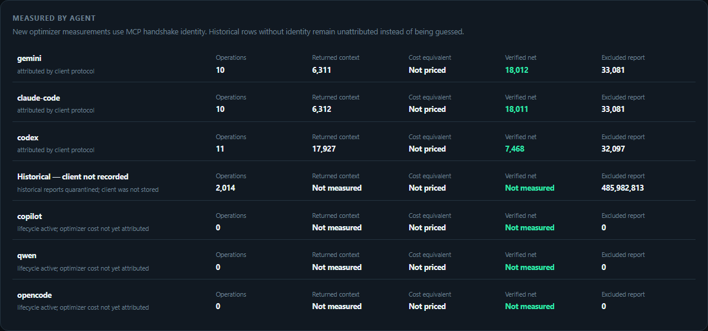
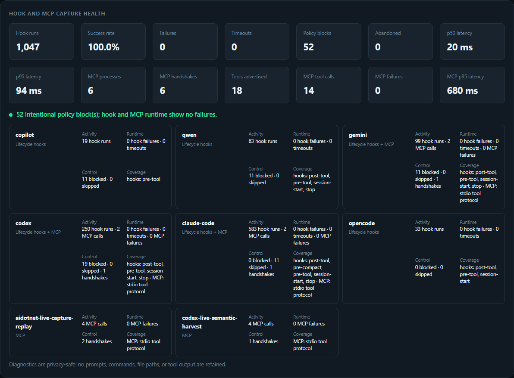
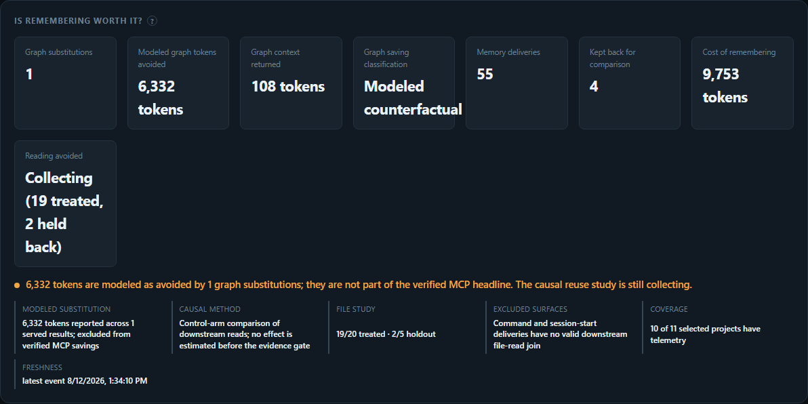
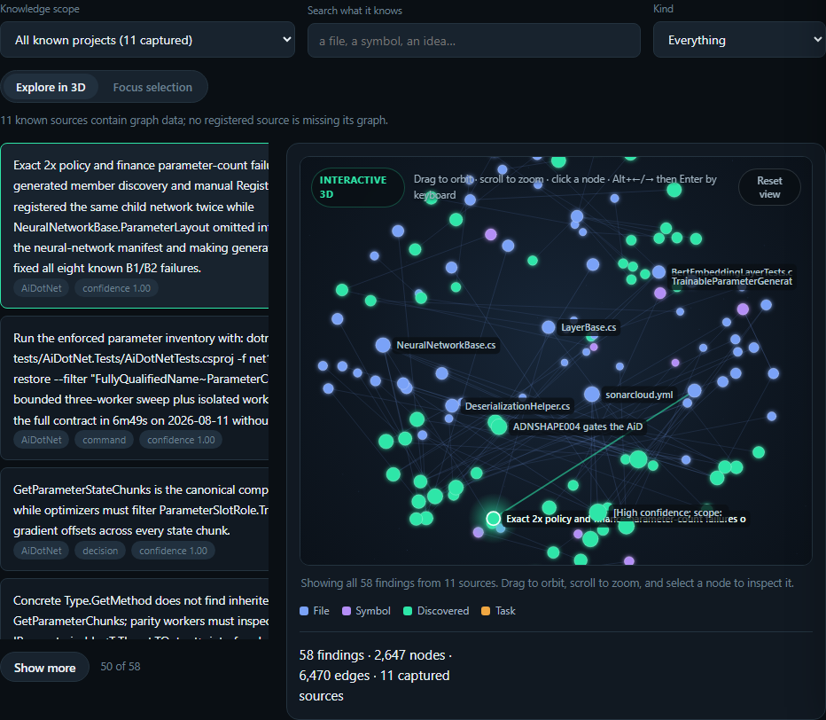

# The dashboard

What the local dashboard shows and how to open it. Back to the [README](../README.md).

## The dashboard

```bash
npm install
npm run build
npm run dashboard      # http://localhost:3100
```

<p align="center">
  
</p>

The overview answers the questions a token optimizer should answer first:

1. **How much MCP context did it avoid?** The headline is gross materialized
   payload reduction minus every later linked expansion. Graph estimates are
   intentionally separate.
2. **How much context still reached the agents?** Every successful current MCP
   result records its actual returned text, even when no valid before-state
   exists. That row is context-accounted but savings-unmeasured.
3. **Which agent and action spent it?** The client ledger and action table show
   operations, returned context, optional cost equivalent, and net tokens
   avoided. Lifecycle-only clients say `Not measured`; no zero is invented.
4. **Did remembering cost more than it saved?** Delivery and semantic-harvest
   tokens are charged to the graph. A causal benefit is added only after the
   treated/holdout evidence gate passes.

### Walkthrough: get useful data, not an empty dashboard

1. Install the MCP server and the native adapter for your CLI. The MCP handshake
   provides per-client accounting; native lifecycle hooks provide automatic
   routing, capture, health, and delivery where the client protocol permits it.
2. Use `smart_read`, `smart_grep`, `smart_glob`, `smart_edit`, or any other MCP
   operation normally. Every successful result records returned context; tools
   with a comparable materialized before-state also record a gross reduction;
   later `expand` calls debit that reduction.
3. Let the active model record durable conclusions with `wiki_write`. Before a
   new agent re-derives work, call `wiki_read` for the project or the files it is
   about to touch. Native clients can also deliver matching knowledge
   automatically.
   Use `wiki_query` to read the graph directly — one finding by key, a ranked
   BM25 search over claims, a node with its neighbours, or the graph's own audit
   — which is how a subagent that never sees the SessionStart briefing reaches
   what previous sessions established.
4. Open `http://localhost:3100`. Use **Overview** for combined accounting and
   **What it knows** for capture health, graph exploration, audits, and causal
   evidence.
5. To register existing local repositories without reading their source, run
   `npm run projects:discover -- /absolute/path/to/repos`. This makes coverage
   gaps explicit; it does not fabricate findings.

For maintainers, this live smoke exercises the shipped stdio transport and
creates separately attributed rows without seeding the analytics database:

```bash
npm run dashboard:attribution-smoke -- /absolute/path/to/project /absolute/path/to/large-file
npm run dashboard:verify-live -- http://localhost:3100
```

<p align="center">
  
</p>

The health panel is deliberately operational rather than a raw text dump. Each
client has activity, runtime failures/timeouts, policy outcomes, and observed
surface coverage. Diagnostics keep no prompts, commands, paths, or tool output.

<p align="center">
  
</p>

Modeled substitution potential and causal graph effects are different claims.
The first is a full-file counterfactual and is never promoted to the verified
MCP headline. The second asks whether delivered knowledge prevented later reads;
it uses a control arm and remains `Collecting` until there are at least 20
treated file touches and 5 holdouts with valid downstream joins.

<p align="center">
  
</p>

Drag to orbit, scroll to zoom, click a node for provenance, or switch to the
bounded one-hop focus view. The default **All known projects** scope pools local
graphs through opaque project IDs; filesystem paths never reach the browser.

**Audit tab.** Contradictions, stale findings, and low-confidence claims remain
reviewable instead of silently becoming model truth.

**Evidence console.** Client/model/task cohorts, matched effects with 95%
intervals, live outcome joins, harm feedback, and capability tiers for all 16
clients. Release and superiority claims fail closed while evidence is missing.

**One-click Markdown export.** The accumulated graph becomes documentation you
can inspect, edit, and commit.

Server-side by design: the browser asks for a neighbourhood, a search result or
a page. A mature graph holds thousands of nodes, and shipping it wholesale would
make every page load a multi-megabyte download for a view that shows twenty
things.

The default **All known projects** scope combines captured graphs through an
opaque machine-local project registry; filesystem paths never reach the
browser. Lifecycle hooks register repositories as they are used. To backfill
existing local checkouts without reading their source files, run the bounded
discovery command against one or more explicit roots:

```bash
npm run projects:discover -- /absolute/path/to/repos /absolute/path/to/worktrees
```

Coverage distinguishes repositories with graph data from known repositories
whose capture has not started. The balance cards are backed by persisted events:
**Memory deliveries** counts graph context actually supplied to an agent,
**Kept back for comparison** counts randomized control touches, and **Cost of
remembering** combines delivered-context tokens with measured semantic-write
payload cost. **Reading avoided** stays `Collecting` or `Not measured` until at
least 20 treated file touches and 5 holdouts exist with a downstream join; the
dashboard does not manufacture a savings estimate from missing data.

See the [cross-client capability contract](CLIENT_SUPPORT.md) and the
[live evaluation suite](../evals/README.md).

### Cross-client lifecycle diagnostics

Every native hook writes the same bounded JSONL lifecycle record, including
Claude Code's custom router and compaction paths. Records carry the client and
plugin versions, event, hashed session/turn correlation, latency, outcome,
input/output byte counts, and response key shape. They deliberately retain no
prompt, command, tool output, file content, or raw working-directory path. The
fields include OpenTelemetry log severity and resource semantics so the local
files can be collected without inventing a second schema.

```bash
npm run diagnostics                         # last 24 hours, summary-first JSON
npm run diagnostics -- --hours 72 --output hook-summary.json
npm run diagnostics -- --include-events --limit 100 --output hook-report.json
```

Raw event rows are opt-in and capped at 1,000. The default report contains aggregate health and
at most twenty recent failures/timeouts, keeping routine troubleshooting output small enough for
CLI and model context windows.

The dashboard's **Capture health** panel shows runs, failures, timeouts and
p50/p95 latency by client. Logs rotate at 5 MiB, retain at most 40 files for 14
days, and live under `.token-optimizer/logs` when a state directory is set (or
`~/.token-optimizer/logs` otherwise). `TOKEN_OPTIMIZER_LOG_DIR`,
`TOKEN_OPTIMIZER_LOG_MAX_BYTES`, `TOKEN_OPTIMIZER_LOG_MAX_FILES`, and
`TOKEN_OPTIMIZER_LOG_RETENTION_DAYS` override those operational defaults.

---
