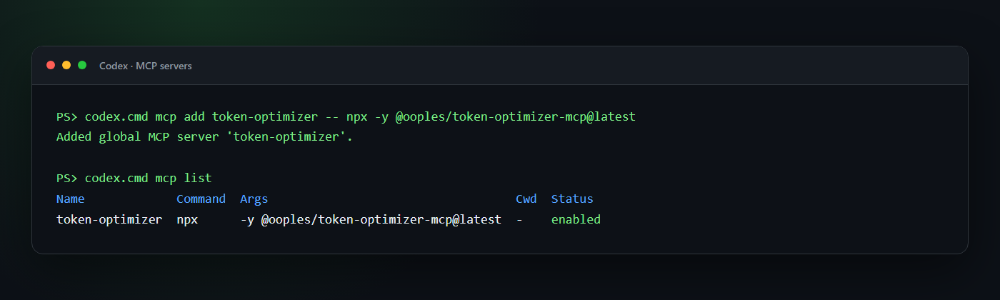

# Installation

Installing on each of the sixteen supported clients, requirements, and how to verify or remove it. Back to the [README](../README.md).

## Quick start

**Claude Code** — install the plugin, not the bare MCP server. The plugin is
what enforces; adding the server alone just gives the model tools it can ignore.

```text
/plugin marketplace add ooples/token-optimizer-mcp
/plugin install token-optimizer@token-optimizer
/reload-plugins
```

That is the entire installation. [All sixteen clients →](#installation)

**Requirements:**
- **Node.js 22.14.0 or later**, for the plugin's hooks and its MCP server. `node` must be on the PATH of the Claude
  Code process.
- **Claude Code 2.1.139 or later.** The hooks use the exec form (`"command": "node", "args": [...]`), which Claude
  Code added in 2.1.139. An older Claude Code ignores `args`, so the hooks do nothing and nothing says so;
  `install_doctor` (or `npx token-optimizer-doctor`) reports it. Their fail-open setting (`"onFailure": "continue"`)
  is read from 2.1.295, and continuing is also the default for an exec-form hook that cannot start.
- **If you just installed Node.js** (or Git), start Claude Code again from a new terminal so it picks up the new PATH.
- **Hooks without Node:** they run `node` directly, with no shell, so Windows needs no Git Bash for them. If `node`
  cannot start, they let the tool call through (`"onFailure": "continue"`): you lose the savings, not the session.
- **MCP server without Node:** it fails to connect (`/mcp` shows it) until Node is reachable. Claude Code retries it
  automatically, or press Reconnect in `/mcp`.

Then, whenever you want to know what to do next:

```text
token_audit
```

One ranked queue: what is costing the most per session, with an optional monthly
cost equivalent only after you configure your own effective rate. Each line
names how to fix it. Not a dashboard, not six reports — a queue.

---

## Installation

Every client launches the same stdio server — `npx -y @ooples/token-optimizer-mcp@latest` —
but they differ in what they let a hook _do_, and that difference is the whole
product. A client with a pre-execution veto can have the wasteful call refused;
one without can only be told. Both are listed honestly below.

Ready-made configuration for all sixteen lives in
[`src/integrations/`](../src/integrations), generated from one source and validated by
`npm run verify:clients`. Full matrix: [`docs/CLIENT_SUPPORT.md`](CLIENT_SUPPORT.md).

Every MCP connection also receives capability-aware mandatory routing
instructions in its `initialize` response. That gives all clients a universal
always-on policy, but only the ten clients with native pre-tool surfaces can
hard-veto a wasteful built-in call; install their lifecycle bundle for actual
enforcement.

### Enforcing tier — the wasteful call is refused

These ten clients expose a pre-execution hook. Their packaged lifecycle bundle
shares one capability-aware decision engine and defaults to `assist`: routing,
retrieval, capture and harvest all on, no refusals. Set
`TOKEN_OPTIMIZER_MODE=enforce` if you want expensive built-in calls vetoed, or
`off` to disable the hooks entirely.

| Client                 | Installable lifecycle surface                                                                                                                    |
| ---------------------- | ------------------------------------------------------------------------------------------------------------------------------------------------ |
| **Claude Code**        | Native plugin: `/plugin marketplace add ooples/token-optimizer-mcp`, then `/plugin install token-optimizer@token-optimizer`                      |
| **Codex**              | Native plugin in [`src/integrations/codex/plugin`](../src/integrations/codex/plugin), or standalone hooks in [`src/integrations/codex`](../src/integrations/codex) |
| **GitHub Copilot CLI** | Project hooks in [`src/integrations/copilot`](../src/integrations/copilot)                                                                                |
| **Gemini CLI**         | Gemini extension at the repository root, backed by [`src/integrations/gemini`](../src/integrations/gemini)                                                |
| **Qwen Code**          | Extension bundle in [`src/integrations/qwen`](../src/integrations/qwen)                                                                                   |
| **Cursor**             | Project hooks and always-applied rule in [`src/integrations/cursor`](../src/integrations/cursor)                                                          |
| **Cline**              | Project hooks and rule in [`src/integrations/cline`](../src/integrations/cline)                                                                           |
| **OpenCode**           | In-process plugin and hooks in [`src/integrations/opencode`](../src/integrations/opencode)                                                                |
| **Kilo**               | In-process plugin and hooks in [`src/integrations/kilo`](../src/integrations/kilo)                                                                        |
| **Windsurf**           | Project hooks and rule in [`src/integrations/windsurf`](../src/integrations/windsurf)                                                                     |

### Rules tier — mandatory routing where the host has no veto API

Roo Code, Zed, Amp, Continue, Crush, and Droid do not expose a packaged
pre-execution bridge that can safely veto built-in calls. Their generated,
always-on rules make optimized routing mandatory whenever the exact MCP schema
is visible, and fail open to a bounded native operation when it is not. The
integration directories contain both the MCP config and the rules file at the
paths documented by each host.

> **These paths are checked, not assumed.** Verifying them against each client's
> published docs found six configs that would have installed cleanly and never
> loaded — including Kilo, whose schema shares nothing with the `mcpServers`
> convention the other clients use. A convention is not a schema.

### Codex

#### 1. Add the MCP server or native plugin

For the best experience, install the Codex plugin. It bundles the MCP server, the token-optimization skill, session guidance, and a large-read hook:

```bash
codex plugin marketplace add ooples/token-optimizer-mcp
codex plugin add token-optimizer@token-optimizer
```

Review and trust the bundled hooks with `/hooks`, then start a new conversation. If you prefer an MCP-only installation, use:

```bash
codex mcp add token-optimizer -- npx -y @ooples/token-optimizer-mcp@latest
```

On Windows, if PowerShell blocks the `codex.ps1` shim, use the command launcher directly:

```powershell
codex.cmd mcp add token-optimizer -- npx -y @ooples/token-optimizer-mcp@latest
```

This writes the server to `~/.codex/config.toml`. Codex CLI, the Codex IDE extension, and the Codex app on the same host share that configuration.

#### 2. Verify the installation

```bash
codex mcp get token-optimizer
codex mcp list
```



Start a new Codex conversation after installation so the new tools are discovered. In an interactive CLI session, `/mcp` shows the tools available to the conversation.

#### 3. Add optimization guidance and hooks

The plugin supplies both automatically. For an MCP-only installation, add the guidance from [`src/integrations/AGENTS.md`](../src/integrations/AGENTS.md) to a project or global `AGENTS.md`. A ready-made standalone hook is also available under [`src/integrations/codex/hooks`](../src/integrations/codex/hooks); merge its `hooks.json` into `~/.codex/hooks.json`, copy the script to `~/.codex/hooks/`, and review it once with `/hooks`.

The Codex hook injects guidance at `SessionStart`. Under `TOKEN_OPTIMIZER_MODE=enforce` it blocks expensive native operations when the bundled MCP has an exact replacement, including a single unambiguous code-mode shell call such as `cat` or `Get-Content`; multi-operation orchestration remains advisory so unrelated work is not discarded, and a second attempt at the same target passes through if the MCP is unavailable. The default is `assist`, which keeps retrieval and capture but never vetoes; `TOKEN_OPTIMIZER_MODE=advise` adds the routing advisory without vetoes, and `off` disables the hooks. The `AGENTS.md`/skill guidance remains important.

If you prefer a smaller instruction block:

```markdown
## Token optimization

Use the token-optimizer MCP for large or repeated reads:

- `smart_read` for files over roughly 400 lines and for files already read once.
- `smart_glob`/`smart_grep` for large search results.
- `optimize_text` to store bulky text outside the model context.
- `get_optimization_report` when the user asks for token or compression stats.

Use normal tools for small, one-off operations.
```

See the current [Codex hooks documentation](https://learn.chatgpt.com/docs/hooks.md) for hook trust, matching, and tool-coverage details.

#### Equivalent manual Codex configuration

If you prefer to edit `~/.codex/config.toml` yourself:

```toml
[mcp_servers.token-optimizer]
command = "npx"
args = ["-y", "@ooples/token-optimizer-mcp@latest"]

# Optional: keep the cache in a custom location.
# env = { TOKEN_OPTIMIZER_CACHE_DIR = "/absolute/path/to/cache" }
```

### Claude Code

**Install the plugin, not the bare MCP server.** The plugin is the only path that
optimizes by default; adding the MCP server alone gives the model a set of tools
it is free to never call.

```text
/plugin marketplace add ooples/token-optimizer-mcp
/plugin install token-optimizer@token-optimizer
/reload-plugins
```

That is the whole installation. There is nothing to configure and no flag to
turn on.

#### What you get immediately

From the first message of the next session, expensive built-in calls are
**refused and redirected** to the optimized equivalent:

| You (or the model) do this                     | What happens                                         |
| ---------------------------------------------- | ---------------------------------------------------- |
| `Read` a file over ~25 KB                      | Denied → `smart_read` (cached)                       |
| `Read` **any** file already read this session  | Denied → `smart_read` (returns only the diff)        |
| `Grep` file contents / `Glob` for files        | Denied → `smart_grep` / `smart_glob`                 |
| `Edit` a file over ~25 KB                      | Denied → `smart_edit` (returns a diff, not the file) |
| `cat`/`head`/`tail`/`Get-Content` a large file | Denied → `smart_read`                                |
| `grep -r` / `rg` across the tree               | Denied → `smart_grep`                                |
| Context fills and compaction starts            | `optimize_session` runs first                        |

The re-read case is usually the largest single win and the one most often
missed: a 5 KB config read fifteen times across a session costs far more than
one 200 KB file read once. Size-based rules never catch it.

#### It cannot get you stuck

Three properties, all tested:

- **Fail-open.** Any error in the optimizer — bad payload, unreadable file,
  unexpected exception — allows the original call through, exactly as if the
  plugin were not installed.
- **Loop-breaking.** A given target is refused **once**. Come back to it and it
  is allowed. So if the MCP server is missing or misconfigured, the cost is one
  wasted turn per file, self-healing, with no intervention.
- **Cheap calls are left alone.** Small files, paged reads, `git log | head`,
  and binary paths are never touched.

#### Turning it down

One variable, no reinstall:

```bash
TOKEN_OPTIMIZER_MODE=advise   # nudge instead of refuse (the pre-5.2 behaviour)
TOKEN_OPTIMIZER_MODE=off      # disable the hooks entirely
TOKEN_OPTIMIZER_LARGE_READ_BYTES=51200   # raise the "large file" threshold
```

#### MCP server only (not recommended)

If you want the tools without the enforcement:

```bash
claude mcp add --transport stdio --scope user token-optimizer -- \
  npx -y @ooples/token-optimizer-mcp@latest
```

Verify with `claude mcp get token-optimizer`, or `/mcp` inside Claude Code. Then
add the recommendations from [`src/integrations/AGENTS.md`](../src/integrations/AGENTS.md)
to your `CLAUDE.md` — but be aware that guidance in a context file is advisory,
and models routinely read past it.

Installing the package changes nothing on your machine. Hooks and managed Claude Code, Codex, and OpenCode commands are wired by one explicit command:

```bash
npm install -g @ooples/token-optimizer-mcp@latest
token-optimizer-install
```

`token-optimizer-install` is the only thing that edits `~/.claude/settings.json`; the install itself prints the path it would write and exits. The hooks it adds match nearly every tool call in every project on the machine, so that is not a side effect an `npm install` should have. Undo it with `token-optimizer-uninstall`, which is a dry run until you pass `--apply`. To activate as part of a container image or provisioning script, set `TOKEN_OPTIMIZER_AUTO_INSTALL=1` before installing. Open a new shell to activate managed CLI commands, or use `token-optimizer-run` directly. See the [hook installation guide](HOOKS-INSTALLATION.md).

### GitHub Copilot CLI

#### 1. Add the MCP server

On current Copilot CLI releases:

```bash
copilot mcp add token-optimizer -- npx -y @ooples/token-optimizer-mcp@latest
```

If your Copilot CLI does not expose `copilot mcp` yet, save this as `~/.copilot/mcp-config.json`:

```json
{
  "mcpServers": {
    "token-optimizer": {
      "type": "local",
      "command": "npx",
      "args": ["-y", "@ooples/token-optimizer-mcp@latest"],
      "tools": ["*"]
    }
  }
}
```

A ready-made copy is available at [`src/integrations/copilot/mcp-config.json`](../src/integrations/copilot/mcp-config.json).

#### 2. Verify the installation

```bash
copilot mcp get token-optimizer
copilot mcp list
```

Inside an interactive Copilot session, `/mcp show token-optimizer` displays the connection status and available tools.

#### 3. Add optimization guidance and hooks

Keep [`src/integrations/AGENTS.md`](../src/integrations/AGENTS.md) as the repository's `AGENTS.md`, or adapt the same guidance into `.github/copilot-instructions.md`.

For native lifecycle integration, install the hooks with the bundled command. It
copies the entry points AND composes the shared core beside them, which a plain
`cp -r` cannot do: the package ships the core once, not ten vendored copies.

```bash
npx -y @ooples/token-optimizer-mcp@latest token-optimizer-install-client --client copilot
```

It writes `.github/hooks/` by default, and `--check` reports what it would
write without writing it. `--dest <dir>` writes to another directory but
changes no client configuration, so it has to be the directory the client's own
config already reads -- which is why the clients that resolve that directory at
runtime (Gemini, Qwen, the Codex plugin) require it.

The hooks inject optimization guidance at `sessionStart`. Under `TOKEN_OPTIMIZER_MODE=enforce` they deny a large built-in `view` so Copilot retries with `smart_read`; the default `assist` leaves the call alone. Partial reads and files below 25 KB always pass through unchanged, and `TOKEN_OPTIMIZER_MODE=advise` gives recommendations without vetoes. Repository hooks work without overwriting user-level files; global hooks can instead be placed in `~/.copilot/hooks/` with their script paths adjusted for that directory.

Restart Copilot CLI after changing hook files. See GitHub's official [MCP setup guide](https://docs.github.com/en/copilot/how-tos/copilot-cli/customize-copilot/add-mcp-servers) and [hooks reference](https://docs.github.com/en/copilot/reference/hooks-reference).

### Gemini CLI

#### 1. Add the MCP server

Add Token Optimizer directly at user scope:

```bash
gemini mcp add --scope user token-optimizer npx -y @ooples/token-optimizer-mcp@latest
```

Alternatively, install this repository as a Gemini extension so the MCP configuration and `GEMINI.md` guidance are packaged together:

```bash
gemini extensions install https://github.com/ooples/token-optimizer-mcp --auto-update
```

#### 2. Verify the installation

```bash
gemini mcp list
gemini extensions list
```

Run `/mcp` inside Gemini CLI to inspect the connection. Restart Gemini CLI after installing or updating the extension.

#### 3. Add optimization guidance and hooks

Direct MCP users should copy [`GEMINI.md`](../GEMINI.md) into the project or merge its rules into an existing `GEMINI.md`. Extension users receive that context file plus native hooks automatically.

The extension's `SessionStart` hook injects optimization guidance. Its `AfterTool` hook notices full-file `read_file` results over 25 KB and suggests `smart_read`. To make Gemini automatically replace those large results with a token-optimizer tail call, configure the extension setting **Automatic large-read routing** as `true`:

```bash
gemini extensions config token-optimizer
```

Automatic routing uses Gemini's native `tailToolCallRequest`: the `smart_read` result replaces the built-in read result before it reaches the model. Partial reads remain unchanged. Restart Gemini CLI after installing, updating, or reconfiguring the extension. See the official [Gemini MCP guide](https://geminicli.com/docs/tools/mcp-server/), [extension guide](https://geminicli.com/docs/extensions/reference/), and [hooks reference](https://geminicli.com/docs/hooks/reference/).

### OpenCode

#### 1. Add the MCP server

Create or update `opencode.json` in your project:

```json
{
  "$schema": "https://opencode.ai/config.json",
  "mcp": {
    "token-optimizer": {
      "type": "local",
      "command": ["npx", "-y", "@ooples/token-optimizer-mcp@latest"],
      "enabled": true
    }
  },
  "instructions": ["./AGENTS.md"]
}
```

For a global installation, merge the same `mcp` entry into `~/.config/opencode/opencode.json`.

#### 2. Verify the installation

```bash
opencode mcp list
```

The output shows configured servers and their connection status.

#### 3. Add optimization guidance and the local plugin

Copy [`src/integrations/AGENTS.md`](../src/integrations/AGENTS.md) to the project as `AGENTS.md`; the `instructions` entry above loads it. Then copy the ready-made local plugin:

```bash
mkdir -p .opencode/plugins
cp src/integrations/opencode/.opencode/plugins/token-optimizer.js .opencode/plugins/
```

```powershell
New-Item -ItemType Directory -Force .opencode/plugins | Out-Null
Copy-Item src/integrations/opencode/.opencode/plugins/token-optimizer.js .opencode/plugins/
```

On OpenCode 1.3.3 or earlier (check `opencode --version`), copy `src/integrations/opencode/legacy/.opencode/plugins/token-optimizer.js` to the same place instead. Those releases call every export of a plugin file as a plugin function, so they cannot load the current file, whose default export is the object OpenCode 2.x requires. Both files have the same name, so copying one replaces the other.

The plugin preserves Token Optimizer usage state in OpenCode's compaction prompt. Under `TOKEN_OPTIMIZER_MODE=enforce` its `tool.execute.before` hook rejects full-file reads over 25 KB and steers the agent to `smart_read`; the default `assist` lets them through. Small and partial reads always pass normally, and `TOKEN_OPTIMIZER_MODE=advise` gives non-blocking guidance. Restart OpenCode after adding the plugin. See the official [OpenCode MCP guide](https://opencode.ai/docs/mcp-servers/) and [plugin hook guide](https://opencode.ai/docs/plugins/).

### Generic MCP configuration

Any stdio-capable MCP client can launch Token Optimizer with:

```json
{
  "mcpServers": {
    "token-optimizer": {
      "command": "npx",
      "args": ["-y", "@ooples/token-optimizer-mcp@latest"]
    }
  }
}
```

Additional ready-made integration files are available for [Claude Desktop](../bench/examples/claude_desktop_config.json), [Codex](../src/integrations/codex/config.toml), [Gemini CLI](../src/integrations/gemini/), [OpenCode](../src/integrations/opencode/), and [GitHub Copilot](../src/integrations/copilot/mcp-config.json).

## Requirements and data

- Node.js 22.14.0 or newer
- npm 9 or newer
- An MCP client with stdio transport support

Default local data locations include:

- cache: `~/.token-optimizer-cache/`
- analytics: `~/.token-optimizer-mcp/analytics.db`
- sessions and configuration: `~/.token-optimizer/`

Set `TOKEN_OPTIMIZER_CACHE_DIR` to override the cache location.

## Verify it, check it, remove it

This installs hooks that **refuse your tool calls**. That is a bigger ask than a
normal dependency makes, so here is everything needed to check it and undo it.

**Verify the release is genuine.** The package is published from CI with npm
provenance, which signs an attestation binding the artifact to the workflow run
and the commit that built it:

```bash
npm audit signatures
```

That verifies without trusting us. A `CHECKSUMS.sha256` is attached to each
GitHub release for offline checking (`sha256sum -c CHECKSUMS.sha256`) — useful
for mirrors, but weaker: it shares a trust root with the thing it hashes.

**Check it actually works.** Not that the files are in place — that it _works_:

```bash
npm run doctor
```

This feeds a synthetic payload to the real hook binary and asserts a large read
is refused and a small one is not, that session-start emits the policy, that the
graph directory is writable, and that the MCP server starts and lists its tools.
Every failure names its own fix. The same examination is an `install_doctor` MCP tool, served with `TOKEN_OPTIMIZER_TOOL_PROFILE=full`.

**Turn enforcement off, instantly.** Every refusal says this, so you never have
to come back here to find it:

```bash
TOKEN_OPTIMIZER_MODE=off      # no enforcement, no hooks
TOKEN_OPTIMIZER_MODE=advise   # suggestions only, nothing is ever denied
```

**Remove it.** The installer records every file it wrote, with hashes, so
removal is exact rather than best-effort:

```bash
npm run uninstall-hooks              # show the plan; changes nothing
npm run uninstall-hooks -- --apply   # carry it out
```

It removes only files that still match what we wrote. Anything you have edited
since is **left in place and named**, because removing it would destroy your
work and removing it silently would be worse. Hooks you added yourself are not
in the manifest and are never touched. Config entries we added are listed for
you to remove — we do not rewrite your `settings.json`.
