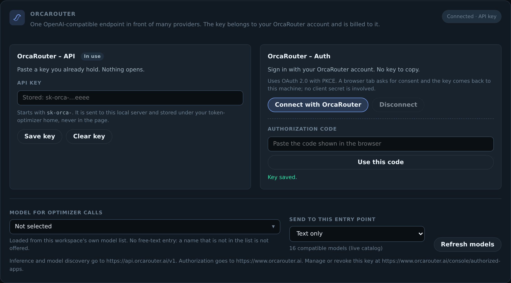
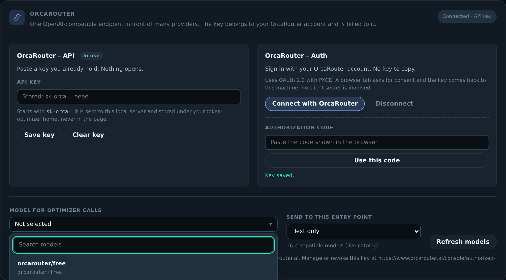
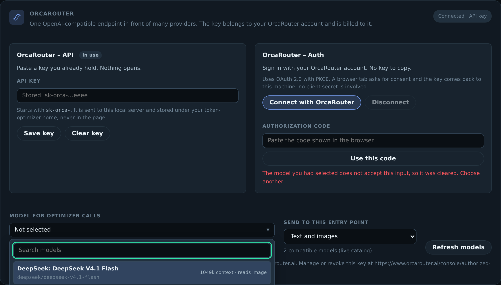

# OrcaRouter

Routing requests through OrcaRouter. Back to the [README](../README.md).

## OrcaRouter

[OrcaRouter](https://www.orcarouter.ai) is an OpenAI-compatible AI gateway that
routes many providers behind one endpoint. It is wired here as a first-class
provider for the optimizer's own model calls, with **two independent ways in**:

| Choice              | Provider id        | What it does                                                       |
| ------------------- | ------------------ | ------------------------------------------------------------------ |
| `OrcaRouter - API`  | `orcarouter`       | You paste an `sk-orca-…` key you already hold. Nothing opens.      |
| `OrcaRouter - Auth` | `orcarouter-oauth` | OAuth 2.0 + PKCE: a browser asks for consent and issues you a key. |

Both produce the same ordinary OrcaRouter API key, and everything downstream —
the Bearer header, the endpoint, model discovery, `401` recovery — is identical
whichever one you used. The two are not interchangeable in the UI on purpose: a
single button that sometimes asks for a key and sometimes opens a browser makes
logout, reauthentication and support harder.



### Configure it

Open the dashboard (`npm run dashboard`) and use the **OrcaRouter** card, or set
it from the environment:

```bash
export ORCAROUTER_API_KEY=sk-orca-…          # the API-key choice
export TOKEN_OPTIMIZER_ORCA_MODEL=orcarouter/auto   # which model the optimizer calls
```

Or connect with an account instead, which writes the issued key under
`$TOKEN_OPTIMIZER_HOME` (default `~/.token-optimizer`) with owner-only
permissions:

```bash
token-optimizer-route orcarouter --connect   # opens a browser, then stores the key
token-optimizer-route orcarouter --status    # shows a redacted status and the origins in use
token-optimizer-route orcarouter --clear     # removes the stored key
```

**A PKCE-issued key is durable, not a refresh token.** OrcaRouter returns a
long-lived key, not an access/refresh pair, so it is reused until you revoke it
at <https://www.orcarouter.ai/console/authorized-apps> — there is no refresh to
schedule and re-authorizing on every launch would hit the account's limit of ten
keys per 24 hours. When the relay answers `401`, the exact account and credential
generation that made the rejected request is marked for reauthentication, and
nothing attempts a refresh. Refreshable OAuth tokens rotate automatically;
durable key grants such as OrcaRouter are reused until the provider revokes them.

### Origins

Authentication and inference are **different hosts**, and neither is derived from
the other:

| Purpose                          | Default                        |
| -------------------------------- | ------------------------------ |
| Consent screen and code exchange | `https://www.orcarouter.ai`    |
| Inference and model discovery    | `https://api.orcarouter.ai/v1` |

`https://api.orcarouter.ai/v1/auth/keys` is a 404 — the auth endpoints are not
under the relay. Self-hosted installs can set `ORCA_BASE_URL` for a single shared
origin, or `ORCA_AUTH_BASE_URL` / `ORCA_API_BASE_URL` separately; explicit values
win, and cleartext HTTP is permitted only for loopback.

### Models

The model control is a listbox built from `GET /v1/models` on the configured
origin, using your own key so the list is what your workspace can actually call.
Model ids keep their `vendor/model` namespace. Options are filtered per entry
point, and a model that does not declare a capability is **not offered** rather
than offered and then rejected:

- text chat — `?capability=chat`, and the model must declare an `openai`,
  `anthropic`, `gemini` or `openai-response` endpoint type;
- multimodal — the same, plus an explicit `architecture.input_modalities` entry
  for the modality being sent (an undeclared capability fails closed);
- embedding, image, video and rerank — matched strictly against the
  `embeddings`, `image-generation`, `openai-video` and `jina-rerank` endpoint
  types.

If discovery fails, a small **verified fallback** list is shown and labelled as
such (`openai/gpt-5.5`, `anthropic/claude-opus-4.8`, `google/gemini-3.5-flash`,
`deepseek/deepseek-v4-pro`, `orcarouter/auto`), with its context, modality and
reasoning-effort metadata intact. A successful live result is authoritative and
never has the fallback mixed into it.

| Text entry point                                                                                    | After switching to images                                                                                                                           |
| --------------------------------------------------------------------------------------------------- | --------------------------------------------------------------------------------------------------------------------------------------------------- |
|  |  |

The second capture is after the entry point is switched to images: the text-only
selection is cleared, and only models whose catalog entry declares image
input remain.

`npm run evidence:orcarouter` regenerates the screenshots and assertions for the
card into `orca-evidence/` (untracked — it is a run artifact). The copies linked
from this README live in `docs/media/orcarouter/`, alongside the other dashboard
captures. A delivery check reads `orca-evidence/` and refuses a patch that ships
it, so the directory is ignored rather than committed.

---
